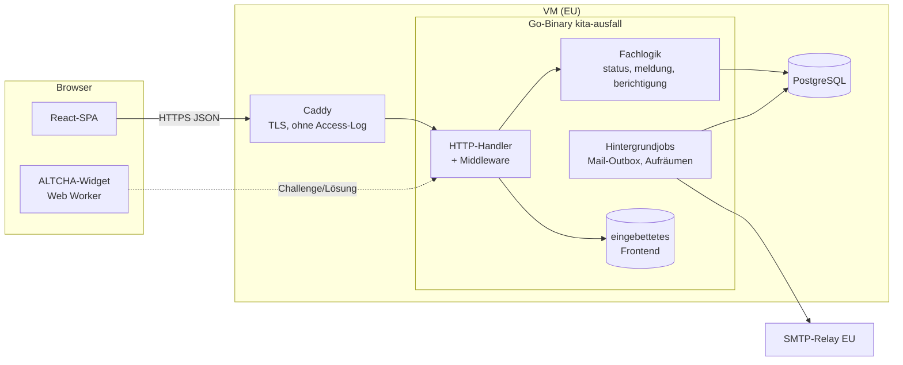

# Technisches Konzept: Kita-Ausfall NRW

Stack: **Go**, **PostgreSQL**, **React**. Leitlinien: **simpel, schnell, sicher**.
Fachliche Grundlagen (Statusmodell, Vertrauensstufen, Datensparsamkeit): [`konzept.md`](konzept.md).

Der bestehende Node-Prototyp dient als **ausführbare Spezifikation**: Seine Tests (Statuslogik, Abläufe) werden nach Go portiert, danach wird er entfernt (siehe [Abschnitt 13](#13-migration-vom-node-prototyp)).

---

## 1. Leitentscheidungen

| Entscheidung | Gewählt | Verworfen | Begründung |
|---|---|---|---|
| Deployment-Einheit | **Ein Go-Binary**, das API *und* das gebaute React-Frontend ausliefert (`embed.FS`) | Getrenntes Frontend-Hosting, Microservices | Ein Artefakt, eine Version, keine CORS-Konfiguration, kein Drittanbieter-CDN |
| HTTP | **Standardbibliothek** `net/http` (Routing mit Methoden-Mustern seit Go 1.22) | chi, gin, echo | Keine Abhängigkeit nötig, langfristig stabil |
| DB-Zugriff | **pgx v5** + **sqlc** (typsicherer Code aus SQL) | ORM (GORM, ent) | Explizites SQL, keine Magie, SQL-Injection konstruktiv ausgeschlossen |
| Migrationen | **goose**, Migrationen ins Binary eingebettet | golang-migrate, Auto-Migration | Einfach, SQL-Dateien, `kita-ausfall migrate` |
| Frontend | **React + Vite + TypeScript**, Single-Page-App | Next.js/SSR | Go bleibt der einzige Server; kein Node in Produktion |
| API-Vertrag | **OpenAPI 3.1** (`api/openapi.yaml`), daraus TS-Typen (`openapi-typescript`) | Typen doppelt pflegen | Eine Quelle der Wahrheit; dient gleichzeitig als Doku der offenen Daten |
| Statusanzeige | **Vorberechnete Tabelle `tagesstatus`**, aktualisiert beim Schreiben | Berechnung bei jedem Lesen | Lesen ist trivial und schnell; Tabelle ist zugleich die langfristige anonyme Statistik |
| Proof-of-Work | **ALTCHA** (`altcha-lib-go/v2` + Widget), PBKDF2/SHA-256 | reCAPTCHA, hCaptcha, Turnstile | Selbst gehostet, kein Tracking, keine Cookies |
| Betrieb | **Eine VM in der EU**, Docker Compose: Caddy + App + Postgres | Kubernetes, Serverless | Reicht für NRW um Größenordnungen; wenig bewegliche Teile |
| Admin | **CLI-Unterbefehle** im selben Binary | Admin-Weboberfläche | Keine zusätzliche Angriffsfläche im Netz |

---

## 2. Architektur



- **Caddy** terminiert TLS (automatische Zertifikate), setzt HSTS und schreibt **kein Access-Log**. Die App sieht die Client-IP über `X-Forwarded-For` (nur von Caddy vertraut).
- Die **App** ist zustandsarm. Flüchtiger Zustand im RAM: Tagesgeheimnis für Melder-Hashes, Rate-Limit-Zähler.
- **Hintergrundjobs** laufen als Goroutinen im selben Prozess (Ticker). Bei mehr als einer Instanz verhindert ein Postgres-Advisory-Lock die doppelte Ausführung.

### Skalierung

Eine Instanz (2 vCPU) schafft mehrere tausend Lesezugriffe pro Sekunde. Für Lastspitzen (z. B. Streiktag mit Presseberichten):

1. Lese-Endpunkte senden `Cache-Control: public, max-age=30, stale-while-revalidate=60`. Caddy oder ein vorgeschalteter EU-Cache kann puffern.
2. **Entscheidung: Wir starten mit genau einer Instanz.** Das Tagesgeheimnis liegt nur im RAM, das ist die stärkste Datenschutzzusage. Bekannte Nebenwirkung: Nach einem Neustart beginnt die Tageszählung für Mehrfachmeldungen und Rate-Limits neu. Deployments legen wir deshalb möglichst in die Nacht.
   Sollte später eine zweite Instanz nötig werden, wandert das Tagesgeheimnis in eine Postgres-Tabelle `tagesgeheimnis`, die täglich gelöscht wird.

---

## 3. Projektstruktur (Monorepo)

```
cmd/kita-ausfall/        main.go – Unterbefehle: serve, migrate, import-osm, link, cleanup
internal/
  config/                Konfiguration aus Umgebungsvariablen, Validierung beim Start
  db/                    sqlc-Ausgabe (generiert)
    queries/*.sql        alle SQL-Abfragen
    migrations/*.sql     goose-Migrationen (eingebettet)
  status/                reine Statuslogik (keine I/O), tabellengetriebene Tests
  meldung/               Use-Cases: anonym melden, per Link melden
  berichtigung/          Anfrage, Mail, Bestätigung
  link/                  Melde-Links erzeugen/prüfen/widerrufen
  pow/                   ALTCHA-Challenge + Verifikation + Replay-Schutz
  privacy/               Melder-Hash, Token-Hashing, IP-Normalisierung
  mail/                  Outbox-Worker, SMTP
  httpapi/               Handler, Middleware, Fehlerformat
  web/                   embed des Frontend-Builds, index.html-Template
api/openapi.yaml         API-Vertrag
web/                     React-App (Vite)
  src/api/               generierte Typen + schlanker fetch-Client
  src/pages/             Start, Kita, Melden, Link-Melden, Berichtigung, Bestätigen, Datenschutz
  src/components/
deploy/                  docker-compose.yml, Caddyfile, Backup-Skript
.github/workflows/       CI
```

---

## 4. Datenmodell (PostgreSQL)

Erweiterungen: `pg_trgm` (unscharfe Namenssuche), `btree_gist` (kombinierter Index Kita + Zeitraum).
Zeiträume werden als **`daterange`** gespeichert. Damit sind Abfragen wie „deckt Tag X ab“ (`zeitraum @> $1`) einfach und per GiST-Index schnell.

```sql
CREATE EXTENSION IF NOT EXISTS pg_trgm;
CREATE EXTENSION IF NOT EXISTS btree_gist;

CREATE TABLE kita (
  id             bigint GENERATED ALWAYS AS IDENTITY PRIMARY KEY,
  quelle         text NOT NULL,                 -- 'kibiz' (Landesdatensatz), 'osm', 'opendata-koeln', ...
  quelle_id      text NOT NULL,
  name           text NOT NULL,
  traeger        text,
  strasse        text,
  plz            text,
  ort            text,
  lat            double precision,
  lon            double precision,
  aktiv          boolean NOT NULL DEFAULT true, -- false, wenn nicht mehr im Landesdatensatz
  UNIQUE (quelle, quelle_id)
);

-- Kontaktadresse getrennt von den Stammdaten, mit Herkunft und Prüfstatus.
-- Nur Funktionsadressen (kita-xy@…), keine personenbezogenen (vorname.nachname@…).
CREATE TABLE kita_kontakt (
  kita_id        bigint PRIMARY KEY REFERENCES kita ON DELETE CASCADE,
  email          text NOT NULL,
  herkunft       text NOT NULL CHECK (herkunft IN ('opendata', 'ifg', 'osm', 'kita_selbst', 'eingeladen', 'manuell')),
  bestaetigt_am  date,                          -- gesetzt, sobald die Kita einen Link an diese Adresse bestätigt hat
  geaendert_am   date NOT NULL
);

-- Weitere Quellen werden der Kita zugeordnet (z. B. OSM-Objekt ↔ KiBiz-Eintrag).
CREATE TABLE kita_zuordnung (
  quelle         text NOT NULL,
  quelle_id      text NOT NULL,
  kita_id        bigint REFERENCES kita ON DELETE CASCADE,  -- NULL = noch ungeklärt
  aehnlichkeit   real,
  geprueft       boolean NOT NULL DEFAULT false,
  PRIMARY KEY (quelle, quelle_id)
);
CREATE INDEX kita_name_trgm ON kita USING gin (name gin_trgm_ops);
CREATE INDEX kita_ort_trgm  ON kita USING gin (ort gin_trgm_ops);
CREATE INDEX kita_plz       ON kita (plz);

CREATE TABLE melde_link (
  id           bigint GENERATED ALWAYS AS IDENTITY PRIMARY KEY,
  kita_id      bigint NOT NULL REFERENCES kita ON DELETE CASCADE,
  rolle        text NOT NULL CHECK (rolle IN ('elternbeirat', 'kita')),
  token_hash   bytea NOT NULL UNIQUE,           -- SHA-256 des Tokens
  gueltig_bis  date NOT NULL,
  widerrufen   boolean NOT NULL DEFAULT false,
  erstellt_am  date NOT NULL
);

CREATE TABLE meldung (
  id           bigint GENERATED ALWAYS AS IDENTITY PRIMARY KEY,
  kita_id      bigint NOT NULL REFERENCES kita ON DELETE CASCADE,
  status       text NOT NULL CHECK (status IN ('regulaer', 'verkuerzt', 'notbetreuung', 'geschlossen')),
  zeitraum     daterange NOT NULL CHECK (NOT isempty(zeitraum) AND upper(zeitraum) - lower(zeitraum) <= 31),
  uhrzeit_von  time,
  uhrzeit_bis  time,
  grund        text CHECK (grund IN ('personalmangel', 'krankheitswelle', 'streik', 'schliesstag', 'sonstiges')),
  quelle       text NOT NULL CHECK (quelle IN ('anonym', 'elternbeirat', 'kita', 'kita_berichtigung')),
  melder_hash  bytea,                           -- nur bei 'anonym'
  link_id      bigint REFERENCES melde_link ON DELETE SET NULL,
  erstellt_am  date NOT NULL,                   -- nur Datum, keine Uhrzeit
  CHECK (status <> 'verkuerzt' OR (uhrzeit_von IS NOT NULL AND uhrzeit_bis > uhrzeit_von)),
  CHECK ((quelle = 'anonym') = (melder_hash IS NOT NULL))
);
CREATE INDEX meldung_kita_zeitraum ON meldung USING gist (kita_id, zeitraum);
CREATE INDEX meldung_ratelimit     ON meldung (kita_id, melder_hash, erstellt_am) WHERE melder_hash IS NOT NULL;

-- Angezeigter Status je Kita und Tag (vorberechnet). Fehlende Zeile = „keine Meldung“.
-- Enthält keine Melderdaten und bleibt dauerhaft als Statistik erhalten.
CREATE TABLE tagesstatus (
  kita_id      bigint NOT NULL REFERENCES kita ON DELETE CASCADE,
  datum        date NOT NULL,
  status       text NOT NULL,
  stufe        smallint NOT NULL,
  uhrzeit_von  time,
  uhrzeit_bis  time,
  grund        text,
  anzahl       smallint NOT NULL DEFAULT 0,
  PRIMARY KEY (kita_id, datum)
);
CREATE INDEX tagesstatus_einschraenkung ON tagesstatus (datum)
  WHERE status IN ('verkuerzt', 'notbetreuung', 'geschlossen');

CREATE TABLE protokoll (
  id           bigint GENERATED ALWAYS AS IDENTITY PRIMARY KEY,
  kita_id      bigint NOT NULL REFERENCES kita ON DELETE CASCADE,
  datum        date NOT NULL,
  alt_status   text NOT NULL,
  neu_status   text NOT NULL,
  neu_stufe    smallint NOT NULL,
  erstellt_am  date NOT NULL
);
CREATE INDEX protokoll_kita ON protokoll (kita_id, id DESC);

CREATE TABLE berichtigung (
  id           bigint GENERATED ALWAYS AS IDENTITY PRIMARY KEY,
  kita_id      bigint NOT NULL REFERENCES kita ON DELETE CASCADE,
  status       text NOT NULL,
  zeitraum     daterange NOT NULL,
  uhrzeit_von  time,
  uhrzeit_bis  time,
  grund        text,
  token_hash   bytea NOT NULL UNIQUE,
  ablauf       date NOT NULL,
  bestaetigt   boolean NOT NULL DEFAULT false,
  erstellt_am  date NOT NULL
);

-- Replay-Schutz für Proof-of-Work, atomar und instanzübergreifend.
CREATE TABLE pow_verwendet (
  nonce  text PRIMARY KEY,
  ablauf timestamptz NOT NULL
);

-- Mails werden transaktional eingereiht und asynchron versendet; nach Versand gelöscht.
CREATE TABLE mail_outbox (
  id                bigint GENERATED ALWAYS AS IDENTITY PRIMARY KEY,
  an                text NOT NULL,
  betreff           text NOT NULL,
  text              text NOT NULL,
  versuche          smallint NOT NULL DEFAULT 0,
  naechster_versuch timestamptz NOT NULL DEFAULT now()
);
```

**Datenbankrollen:** `kita_migrate` (DDL, nur für Migrationen) und `kita_app` (nur `SELECT/INSERT/UPDATE/DELETE` auf die Tabellen). Die App läuft mit `kita_app`.

### 4.1 Kita-Stammdaten und Kontaktadressen

Ausführlich begründet in [`konzept.md`, Abschnitt 8](konzept.md#8-kita-stammdaten-für-nrw). Technisch:

| Schritt | Umsetzung |
|---|---|
| **Basis: Landesdatensatz** „Kindertageseinrichtungen in NRW“ (aus KiBiz.web, monatlich aktualisiert, Datenlizenz Deutschland – Namensnennung 2.0) | `kita-ausfall import kibiz` lädt den Datensatz monatlich (Download/Atom-Feed von GEOportal.NRW bzw. open.nrw). Upsert über die Einrichtungs-ID des Datensatzes. Einrichtungen, die fehlen, werden `aktiv = false` gesetzt, nicht gelöscht, weil ihre Historie erhalten bleiben soll. |
| **Ergänzung: kommunale Open Data, OSM** | `kita-ausfall import <quelle>` schreibt in `kita_zuordnung`. Automatischer Abgleich über normalisierte Adresse (PLZ + Straße + Hausnummer) und Namensähnlichkeit (`pg_trgm`). Ab hoher Ähnlichkeit wird automatisch zugeordnet, sonst landet der Eintrag in einer Prüfliste (`kita-ausfall zuordnung pruefen`). Übernommen werden nur E-Mail-Adressen, keine anderen Felder. |
| **E-Mail-Filter** | Adressen, die wie Personen aussehen (`vorname.nachname@`, `v.nachname@`), werden beim Import verworfen. Erlaubt sind nur Funktionsadressen. |
| **Kontakt per Selbstauskunft** | Eine Kita (oder der Elternbeirat für sie) trägt eine Adresse ein → Bestätigungsmail an diese Adresse → erst nach Klick `kita_kontakt` mit `herkunft = 'kita_selbst'` bzw. `'eingeladen'`. Eine bereits bestätigte Adresse kann nur von der bisherigen Adresse aus oder manuell geändert werden. |
| **Kita fehlt** | Meldeformular „Kita fehlt“ (Name, Adresse, mit PoW) → Prüfliste. Wird erst nach Abgleich mit dem nächsten Landesdatensatz oder manueller Prüfung freigeschaltet. |

> **Noch zu prüfen**, bevor Phase 1 fertig ist: genaue Feldnamen, Einrichtungs-ID und Download-URL des Landesdatensatzes. Aus der Sandbox heraus waren die Portale nicht erreichbar. Laut Katalogbeschreibung enthält er Name, Adresse, Anzahl Gruppen und Plätze; Träger und E-Mail sind dort nicht aufgeführt.

---

## 5. Kernabläufe

### 5.1 Anonyme Meldung

```mermaid
sequenceDiagram
  participant B as Browser
  participant A as Go-App
  participant D as Postgres
  B->>A: GET /api/v1/pow/challenge
  A-->>B: signierte Challenge (läuft nach 10 min ab)
  Note over B: Widget rechnet im Web Worker (~2–4 s),<br/>parallel füllt man das Formular aus
  B->>A: POST /api/v1/kitas/{id}/meldungen {status, zeitraum, …, altcha}
  A->>A: Größenlimit, Origin-Prüfung, Rate-Limit (RAM)
  A->>A: PoW prüfen (Signatur, Ablauf, Lösung)
  A->>D: INSERT pow_verwendet ON CONFLICT DO NOTHING
  A->>A: Eingaben validieren, melder_hash = HMAC(Tagesgeheimnis, IP-Präfix | UA | Kita)
  A->>D: BEGIN; SELECT … FROM kita WHERE id=$1 FOR UPDATE
  A->>D: Tageslimit prüfen, INSERT meldung
  A->>D: Meldungen im Zeitraum laden
  A->>A: status.Berechne() je Tag
  A->>D: UPSERT tagesstatus, INSERT protokoll (nur geänderte Tage); COMMIT
  A-->>B: 201 + neuer Status
```

- `FOR UPDATE` auf die Kita **serialisiert Schreibvorgänge pro Kita**. Damit gibt es keine Wettläufe bei der Neuberechnung, und andere Kitas sind nicht blockiert.
- Die **Statuslogik ist eine reine Funktion** (`internal/status`), ohne I/O, mit tabellengetriebenen Tests.

### 5.2 Melden per Link (Elternbeirat/Kita)

Gleicher Ablauf ohne PoW und ohne Tageslimit. Die Quelle ergibt sich aus der Rolle des Links. Zum Token siehe [7.3](#73-tokens-in-links).

### 5.3 Berichtigung

1. `POST /api/v1/kitas/{id}/berichtigungen` (mit PoW): Die App prüft das Limit von 3 Anfragen pro Kita und Tag, legt die Berichtigung an und reiht **in derselben Transaktion** eine Mail an die öffentliche Kita-Adresse in `mail_outbox` ein.
2. Der Outbox-Worker versendet die Mail (Wiederholung mit Backoff) und löscht sie danach.
3. Die Kita öffnet den Link. Die SPA zeigt die Zusammenfassung (`GET /api/v1/berichtigungen/aktuell`, Token im Header), bestätigt wird erst per Klick (`POST …/bestaetigen`). So können Link-Scanner in Mailprogrammen nichts auslösen.
4. Die Bestätigung schreibt eine Meldung mit Quelle `kita_berichtigung` (Ablauf wie 5.1 ab `BEGIN`).

---

## 6. API

REST/JSON unter `/api/v1`, Fehler im Format **RFC 9457** (`application/problem+json`) mit deutschsprachigem `detail`. Validierungsfehler enthalten ein Feld `fehler: [{feld, meldung}]`.

| Methode & Pfad | Zweck | Schutz |
|---|---|---|
| `GET /kitas?q=&plz=` | Suche (max. 50 Treffer) inkl. heutigem Status | Rate-Limit |
| `GET /kitas/{id}` | Stammdaten (ohne Kontaktadresse) + 14 Tage Status + Protokoll | Cache 30 s |
| `GET /status?datum=` | Alle Einschränkungen an einem Tag (offene Daten) | Cache 30 s |
| `GET /pow/challenge` | PoW-Challenge | Rate-Limit, `no-store` |
| `POST /kitas/{id}/meldungen` | Anonyme Meldung | PoW, Rate-Limits |
| `GET /link` | Kita und Rolle zum Link-Token | `Authorization: Link <token>` |
| `POST /link/meldungen` | Verifizierte Meldung | `Authorization: Link <token>` |
| `POST /kitas/{id}/berichtigungen` | Berichtigung anfragen | PoW, 3/Kita/Tag |
| `GET /berichtigungen/aktuell` | Zusammenfassung zur Bestätigung | `Authorization: Berichtigung <token>` |
| `POST /berichtigungen/aktuell/bestaetigen` | Bestätigen | dto. |
| `POST /kitas/{id}/einladungen` | Elternbeirat beantragt Link, Kita bestätigt per Mail (Ablauf in `konzept.md`, Abschnitt 6) | PoW, 3/Kita/Tag |
| `POST /kitas/{id}/kontakt` | Kita trägt Funktionsadresse ein → Bestätigungsmail | PoW, 3/Kita/Tag |
| `POST /kitas/fehlend` | „Kita fehlt“ melden → Prüfliste | PoW |
| `GET /healthz`, `GET /readyz` | Liveness/Readiness | nur intern (Caddy leitet nicht weiter) |

Die offenen Daten (`/status`, `/kitas/{id}`) sind unter einer freien Lizenz veröffentlicht (Vorschlag: CC BY 4.0 für Statusdaten; Stammdaten aus OSM unter ODbL).

---

## 7. Sicherheit

### 7.1 Bedrohungsmodell (Kurzfassung)

| Bedrohung | Maßnahme |
|---|---|
| Massenhafte Falschmeldungen | PoW, Rate-Limit pro IP (RAM) und pro Gerät/Kita/Tag (DB), Vertrauensstufen, Mehrheitsprinzip |
| Gezielte Falschmeldung gegen eine Kita | Bleibt „unbestätigt“; Elternbeirat/Kita überstimmen; Berichtigung hat Vorrang; öffentliches Protokoll |
| Mailbombing einer Kita über Berichtigungen | PoW + max. 3 Anfragen/Kita/Tag + Mail nur an hinterlegte Adresse |
| Abgreifen von Link-Tokens | Token im URL-Fragment (nie in Server-Logs/Referer), 256 Bit, nur Hash gespeichert, Ablauf, Widerruf |
| SQL-Injection | Ausschließlich parametrisierte Abfragen via sqlc |
| XSS | React escaped standardmäßig; `dangerouslySetInnerHTML` per Lint verboten; strikte CSP ohne Inline-Skripte |
| CSRF | Keine Cookies/Sessions; POSTs nur mit `Content-Type: application/json` und passendem `Origin` |
| DoS | Timeouts am `http.Server`, `MaxBytesReader` (8 KB), Rate-Limits, Caching der Lesepfade |
| Datenabfluss bei Einbruch | Es gibt kaum etwas zu stehlen: keine IPs, keine Konten, Tokens nur als Hash, Melder-Hashes ohne Tagesgeheimnis wertlos |
| Lieferkette | Wenige Abhängigkeiten, Lockfiles, `govulncheck`, `npm audit`, Dependabot, gepinnte Versionen |

### 7.2 HTTP-Härtung

- `http.Server` mit `ReadHeaderTimeout: 5s`, `ReadTimeout: 10s`, `WriteTimeout: 15s`, `IdleTimeout: 60s`, `MaxHeaderBytes: 16 KB`.
- Security-Header (Middleware):
  - `Content-Security-Policy: default-src 'self'; script-src 'self'; style-src 'self'; worker-src 'self'; img-src 'self' data:; connect-src 'self'; form-action 'self'; frame-ancestors 'none'; base-uri 'none'`
    - Für die strikte CSP wird der **„external“-Build des ALTCHA-Widgets** genutzt (CSS als Datei, Worker als eigene Datei statt Blob/Inline).
  - `Strict-Transport-Security` (über Caddy), `X-Content-Type-Options: nosniff`, `Referrer-Policy: no-referrer`, `Permissions-Policy: geolocation=(), camera=(), microphone=()`, `Cross-Origin-Opener-Policy: same-origin`.
- Panics werden abgefangen (Recover-Middleware) und ohne Interna beantwortet.

### 7.3 Tokens in Links

Links haben die Form `https://…/m#<token>` bzw. `https://…/berichtigung#<token>`.
Das **Fragment wird vom Browser nie an den Server gesendet**. Damit landet das Token weder in Proxy-Logs noch im Referer. Die SPA liest das Fragment, schickt es im `Authorization`-Header und entfernt es per `history.replaceState` aus der Adresszeile.

- Tokens: 32 Byte aus `crypto/rand`, Base64url.
- Gespeichert wird nur `SHA-256(token)`. Lookup per Hash (ein Timing-Angriff ist bei 256-Bit-Zufallstokens irrelevant).

### 7.4 Melder-Hash und Rate-Limit

- `melder_hash = HMAC-SHA256(tagesgeheimnis, ip_praefix ‖ user_agent ‖ kita_id)[:16]`
  - `ip_praefix`: IPv4 vollständig, **IPv6 auf /64 gekürzt** (Privacy Extensions wechseln die hinteren Bits).
  - `tagesgeheimnis`: 32 Zufallsbytes, nur im RAM, Wechsel um Mitternacht (Europe/Berlin) und bei jedem Neustart.
- Rate-Limit im RAM: Token-Bucket je `HMAC(tagesgeheimnis, ip_praefix)`, z. B. 20 Challenges/min und 30 POSTs/h. Die Einträge verfallen nach 1 h.

### 7.5 Betriebssicherheit

- Container: **distroless/static**, läuft als non-root, `read_only: true`, `cap_drop: [ALL]`, `no-new-privileges`.
- Postgres nur im internen Docker-Netz, nicht exponiert.
- Secrets (`ALTCHA_HMAC_SECRET`, DB-Passwörter, SMTP) als Docker-Secrets bzw. Datei-Variablen, nie im Repo.
- SSH nur mit Schlüssel, Firewall: nur 22/80/443. Automatische Sicherheitsupdates des Hosts.
- **Backups:** nächtliches `pg_dump`, mit `age` verschlüsselt, auf EU-Objektspeicher, **14 Tage Aufbewahrung**. Kurz genug, damit die Löschfristen auch in Backups greifen.

---

## 8. Datenschutz – technische Umsetzung

| Zusage | Technische Umsetzung |
|---|---|
| Keine IP-Adressen | Caddy ohne Access-Log; App loggt keine Request-Metadaten; `slog`-Handler mit Allowlist für Felder |
| Keine Uhrzeit bei Meldungen | Spalte `erstellt_am date` |
| Kein Freitext | Nur Enums/CHECK-Constraints; API lehnt unbekannte Felder ab (`DisallowUnknownFields`) |
| Löschfristen | Job täglich: `meldung` 180 Tage nach Zeitraumende, `berichtigung` nach Ablauf/30 Tagen, `pow_verwendet` nach Ablauf, `melde_link` nach Ablauf/Widerruf, `mail_outbox` nach Versand (max. 7 Tage bei Fehlschlag) |
| Keine Dritten | Keine CDNs, Webfonts oder Analytics; alles aus dem Binary. SMTP-Relay mit AV-Vertrag in der EU |
| Kontaktadressen nicht öffentlich | Getrennte DTOs für öffentliche API; Test stellt sicher, dass `kontakt_email` nie serialisiert wird |

---

## 9. Frontend (React) – Mobile first

Die meisten Eltern kommen **vom Handy**, oft über einen Link aus der Eltern-WhatsApp-Gruppe, morgens zwischen Tür und Angel und mit schlechtem Netz. Darauf wird zuerst optimiert; Desktop ist die Erweiterung.

### 9.1 Technik

- **Vite + React 19 + TypeScript (strict)**, `react-router` (Library-Modus), **TanStack Query** für Laden, Caching und Neuladen nach Meldungen.
- Kein UI-Framework: schlichtes CSS mit Custom Properties (heller/dunkler Modus), Layout ab **360 px Breite** entworfen.
- **ALTCHA-Widget** als Web Component, **lazy geladen** nur auf Formularseiten.
- Seiten: Start (Meine Kitas, Suche, Einschränkungen heute), Kita (14-Tage-Status, Protokoll, Melden), Link-Melden, Berichtigung anfragen/bestätigen, Datenschutz/Funktionsweise.

### 9.2 Die wichtigsten Abläufe auf dem Handy

| Ablauf | Ziel | Umsetzung |
|---|---|---|
| **„Ist heute bei meiner Kita etwas?“** | Antwort in < 2 s nach dem Öffnen | **Meine Kitas**: als Favoriten nur auf dem Gerät gespeichert (`localStorage`, kein Konto). Die Startseite zeigt sie ganz oben mit dem Status von heute und morgen. |
| **Link aus der Eltern-Gruppe öffnen** | Kita-Seite sofort lesbar, auch im In-App-Browser von WhatsApp/Instagram | Go setzt Titel und Vorschau (Open Graph: Kita, Ort, Status heute) serverseitig und **bettet die Daten der Seite als JSON in `index.html` ein**. Damit entfällt die zweite Netzwerkrunde vor der ersten Anzeige. |
| **Einschränkung melden** | In ≤ 15 s, mit einer Hand | Unten fest platzierter Knopf „Einschränkung melden“ öffnet ein Bottom Sheet. Große Auswahlkarten statt kleiner Radiobuttons. Schnellauswahl „Heute“, „Morgen“, „Heute + morgen“ statt Datumsfelder. Native Zeitauswahl. Der Proof-of-Work startet beim Öffnen des Sheets und rechnet, während man auswählt. |
| **Weitersagen** | Mit einem Tipp in die Eltern-Gruppe | „Teilen“-Knopf über die Web Share API (Rückfall: Link kopieren). |
| **Kita finden** | Ohne Tippen | „Kitas in meiner Nähe“: Der Standort wird **auf dem Gerät auf ca. 1 km gerundet**, bevor er an den Server geht, und dort nicht gespeichert. Alternativ Suche nach Name, Ort oder PLZ. |
| **Elternbeirat meldet** | Link nicht jedes Mal heraussuchen | Option „Auf diesem Gerät merken“ legt das Link-Token lokal ab (bewusste Entscheidung des Nutzers, jederzeit löschbar). |

### 9.3 Progressive Web App

- **Installierbar** (Web-App-Manifest, Icons): Wer möchte, legt die Seite wie eine App auf den Homescreen. Kein App Store nötig.
- **Service Worker** (Workbox oder schlank selbst geschrieben): App-Hülle offline verfügbar; der zuletzt geladene Status von *Meine Kitas* bleibt sichtbar, deutlich markiert mit „Stand: … – offline“.
- **Keine Push-Benachrichtigungen** im ersten Schritt (bräuchten Abo-Kennungen bei Google/Apple). Später als Alternative: Kalender-Abo (ICS) pro Kita, das jedes Handy nativ kann.

### 9.4 Budgets und Qualität

| Kennzahl | Ziel |
|---|---|
| JavaScript initial | ≤ 80 KB gzip (ohne ALTCHA-Widget), Code-Splitting pro Route |
| Largest Contentful Paint | < 2,0 s auf Mittelklasse-Android über langsames 4G (Lighthouse-Profil „Mobile“) |
| Proof-of-Work | ≤ 3 s auf einem günstigen Android-Gerät (Messung, dann `ALTCHA_COUNTER_*` anpassen) |
| Bedienung | Touch-Ziele ≥ 44 × 44 px, Schrift ≥ 16 px (kein Auto-Zoom bei iOS), funktioniert mit 200 % Schriftgröße, `safe-area-inset` für Notch/Home-Leiste |
| Barrierefreiheit | WCAG 2.1 AA; Status nie nur über Farbe |

- **Tests:** Playwright mit Geräteprofilen (iPhone SE, Pixel 7, ein kleines Android), Lighthouse CI mit Mobile-Profil als Pflichtprüfung in der CI (Performance ≥ 90, Barrierefreiheit ≥ 95). Vor dem Start einmal manuell auf echten Geräten, inklusive In-App-Browser von WhatsApp.
- Ohne JavaScript: Hinweisseite (`<noscript>`). Melden geht ohnehin nur mit PoW, also mit JavaScript.

---

## 10. Performance-Ziele

| Pfad | Ziel (p95, Server) | Mittel |
|---|---|---|
| `GET /kitas/{id}` | < 20 ms | PK-Lookup + `tagesstatus` per PK-Bereich |
| `GET /status?datum=` | < 30 ms | Partieller Index auf `tagesstatus (datum)` |
| `GET /kitas?q=` | < 50 ms | `pg_trgm`-GIN-Index |
| `POST …/meldungen` | < 50 ms (ohne PoW-Prüfung) | Eine Transaktion, Zeile pro Kita gesperrt |
| PoW-Prüfung | < 5 ms | Server prüft nur einen Ableitungsschritt |

pgx-Pool: 10–20 Verbindungen. Prepared Statements macht pgx automatisch.

---

## 11. Tests und Qualität

| Ebene | Werkzeug | Inhalt |
|---|---|---|
| Unit (Go) | `go test`, tabellengetrieben | `status`-Logik (aus dem Prototyp portiert), Validierung, Datums-/Zeitzonenlogik, Hash/IP-Präfix |
| Integration (Go) | `go test` gegen echtes Postgres (CI-Service-Container, `TEST_DATABASE_URL`) | Alle Abläufe aus Abschnitt 5, Rate-Limits, Replay-Schutz, Löschfristen, „keine Kontaktadresse in API“ |
| Frontend | Vitest + Testing Library | Formularlogik, Fehleranzeige |
| E2E | Playwright | Anonym melden (inkl. echtem PoW), Link-Meldung, Berichtigung bis Bestätigung |
| Statisch | `go vet`, `staticcheck`, `govulncheck`, `tsc --noEmit`, ESLint (inkl. Verbot `dangerouslySetInnerHTML`) | in CI |

**CI (GitHub Actions):** Lint → Tests (Go + Postgres-Service) → Frontend-Build → Go-Build mit eingebettetem Frontend → E2E gegen das fertige Binary → Container-Image (nur auf `main`). Dependabot für Go-Module, npm und Actions; Actions auf Commit-SHA gepinnt.

---

## 12. Konfiguration

Wie im Prototyp über Umgebungsvariablen (siehe README), ergänzt um:

| Variable | Beschreibung |
|---|---|
| `DATABASE_URL` | `postgres://kita_app:…@db:5432/kita?sslmode=…` |
| `TRUSTED_PROXY_CIDRS` | Netze, deren `X-Forwarded-For` vertraut wird (Caddy) |
| `ALTCHA_HMAC_SECRET_FILE` | Secret als Datei (Docker-Secret) |

Die App **startet nicht**, wenn in Produktion Pflichtwerte fehlen oder unsicher sind (z. B. kurzes Secret, `BASE_URL` ohne HTTPS).

---

## 13. Migration vom Node-Prototyp

| Phase | Inhalt | Ergebnis |
|---|---|---|
| 1 | Go-Grundgerüst, Migrationen, sqlc, `status` + Tests portiert, Import des Landesdatensatzes (KiBiz) und OSM als CLI | Statuslogik identisch zum Prototyp, alle NRW-Kitas in der DB |
| 2 | API vollständig nach OpenAPI, Integrationstests (Abläufe aus `test/app.test.ts`) | Backend-Parität |
| 3 | React-Frontend mobile first inkl. PWA, E2E-Tests mit Geräteprofilen, Lighthouse CI | Funktionsgleich zum Prototyp, auf dem Handy schnell |
| 4 | Deployment (Compose, Caddy, Backups), Prototyp entfernen | Produktiv in NRW |
| 5 | Erweiterungen: DKIM-Stufe, ICS/RSS-Feed pro Kita, weitere Stammdatenquellen, Auswertungen | |

---

## 14. Bewusst nicht (vorerst)

- **Kein Benutzerkonto-System**, auch nicht für Kitas: Links und Berichtigungen per Mail genügen.
- **Keine Karte** mit externen Kacheln (würde IPs an Kachelserver geben). Später ggf. selbst gehostete Vektorkacheln.
- **Keine Push-Benachrichtigungen** (bräuchten Geräte-IDs). Stattdessen später ICS-/RSS-Feeds pro Kita.
- **Kein ZK-Email** im ersten Schritt (Begründung in `konzept.md`, Abschnitt 7).
